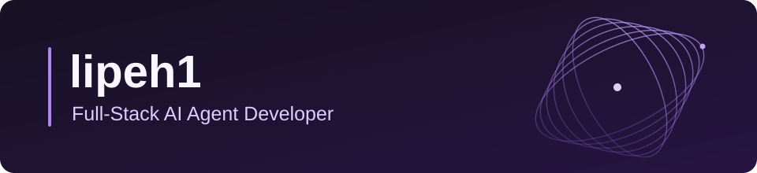

**AI Agent 全栈开发**

I build AI agents that use tools and resume across turns, along with the web apps people use to work with them.  
我做能调用工具、跨轮继续任务的 AI Agent，也开发与它们交互的 Web 应用。

## Projects · 个人项目

- [Yiqikan](https://github.com/lipeh1/yiqikan) · Watch together with screen sharing and voice/video calls. / 支持屏幕共享和音视频连麦的一起看片工具。
- [IELTS Coach](https://github.com/lipeh1/ielts-coach) · IELTS practice with AI writing feedback and study tracking. / 带 AI 写作反馈和学习记录的雅思练习工具。

## Open source · 开源贡献

- [DeepTutor #2581](https://github.com/HKUDS/DeepTutor/pull/2581) · Fixed GitHub sync reporting success when no supported files were imported. / 修复 GitHub 同步未导入任何受支持文件却报成功的问题。
- [RocketMQ-Rust #12705](https://github.com/mxsm/rocketmq-rust/pull/12705) · Cached cluster capabilities to avoid repeat requests during dashboard navigation. / 缓存集群能力信息，避免切换页面时重复查询。
- [phi #487](https://github.com/pulseaiclub/phi/pull/487) · Fixed HTTP server URL display in `mcp list`. / 修复 `mcp list` 中 HTTP 服务地址的显示。
